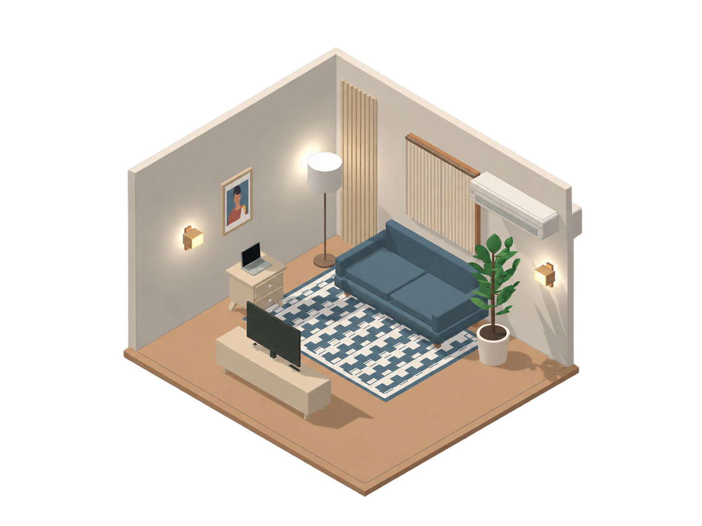

# Nook

### Make room for your ideas.



**Introducing Nook: a friendly, browser-based room planner for turning an early idea into a room you can explore.** Set up a room, try a curated selection of furniture and décor, and see your changes immediately in 3D and in a floor-plan view. Nook is designed for people who want to try out a space without first learning professional CAD or 3D modelling software.

Nook is a practical planning and visualization tool. It helps you explore proportions, placement, finishes, and overall feel; it does not replace professional interior-design or construction documentation.

## What you can do

- **Shape a room:** set its dimensions and wall height, and choose a supported room footprint.
- **Add the room details:** place doors, archways, windows, and other openings; furnish the floor and decorate the walls.
- **Browse before placing:** catalogue cards show prepared object previews so you can see an item before it enters the room.
- **Arrange and refine:** drag objects into position, move them in the scene, rotate them, adjust supported colours and finishes, and reuse saved styles.
- **Explore from different angles:** orbit and zoom through the 3D room, use preset views, raise or lower the walls, and lock a camera angle while arranging objects. Switch to the 2D plan to check the layout from above. Mouse, touch, and on-screen camera controls are available.
- **Keep design notes:** attach comments to room objects, then resolve or remove them as an idea changes.
- **Save and revisit:** save multiple projects in this browser and pin useful ones for quick access.
- **Create shareable outputs:** export a room image or plan as PNG, a dimensioned floor plan and object schedule as SVG, a 3D scene as GLB, or a short room-view video as MP4.

The current room limit is **24 placed floor and wall objects**. The catalogue can contain more options than can be placed in one room at a time.

## How to use Nook

1. **Open the planner** from the homepage, then choose a room shape and enter the room’s measured dimensions and wall height.
2. **Add openings** using the Doors & Entryways and Walls panels. Set up windows and wall features before arranging furniture if you already know where they belong.
3. **Browse the object catalogue.** Select a category and look through the preview cards. Click an item to add it, or drag it into the room to choose its position directly.
4. **Arrange the room.** Drag placed objects to move them. Select an object to rotate it, edit available finishes, adjust its height when supported, save a style, add a comment, duplicate it, or remove it.
5. **Review the layout.** Drag empty space in the 3D view to orbit, use the wheel or pinch gesture to zoom, and try the view presets. Switch to 2D to inspect spacing and object footprints. Use **Lock view** to hold an angle while you continue placing objects.
6. **Save and export.** Save the project on this device, then export the view or plan that best communicates the idea.

### Make the most of a first layout

- Start with measured room dimensions and openings so the furniture arrangement has useful context.
- Place large pieces first, then add smaller items and wall décor.
- Use the 2D plan to review clearances and the 3D view to compare composition, height, and finishes.
- Try a couple of arrangements before settling on one. Object comments can capture questions or decisions while you compare.
- Save before making a major variation. Use PNG for a quick visual, SVG for a plan with dimensions and an item schedule, GLB for a compatible 3D workflow, and MP4 for a short view of the room.

## Nook’s visual identity

Nook pairs a stylized, softly lit isometric room aesthetic with a calm, approachable interface. The visual system uses **deep Nook blue** (`#2A4A92`), **warm ivory** (`#F4F2EB`), and a bright **lime accent** (`#C1FF72`). The wordmark and headings use Clash Display; Creato is used for interface text. Together, the simple room forms, curated object models, and restrained palette keep the experience coherent while furniture styles vary across the catalogue.

## Current scope

Nook is currently a local-first browser application:

- Saved projects and project comments stay in the current browser’s local storage. They are not uploaded to a Nook account or shared with other people.
- There is no account system, cloud backup, live co-editing, or project-sharing link in this version. Collaboration is a planned area of future development.
- Catalogue items are curated models with supported finish options. Nook is for exploring an initial idea, not for producing construction-ready measurements or photorealistic renders.
- The interface and models are designed to feel consistent and responsive as the catalogue grows. Future catalogue packs, more objects, and additional features are planned; they will be introduced in updates as they become ready.

## Run Nook locally

Use Node.js **22.12 or newer** (Node 22 LTS recommended).

```sh
git clone https://github.com/Aljeu/nook-room-designer.git
cd nook-room-designer
npm ci
npm run dev
```

Open the local URL printed by Vite. The homepage is at `/` and the planner is at `/editor/`.

For a production build and local preview:

```sh
npm run build
npx vite preview
```

Recent desktop browsers with WebGL enabled are recommended for the 3D editor. Saved projects belong to the current browser, device, hostname, and port; they do not automatically transfer when any of these change. Export a copy if you need to keep a portable record.

## Development commands

```sh
npm test                 # Run the test suite
npm run typecheck        # Check TypeScript
npm run thumbnails:check # Verify prepared catalogue previews
npm run build            # Type-check and create the production build
npm audit                # Check dependencies against known advisories
```

When catalogue or model changes require new prepared preview images, see the [thumbnail generation guide](scripts/thumbnail-generator/README.md). The generated preview images and their manifest are part of the application and should be kept in sync.

## How it is built

Nook uses React and TypeScript for the interface, Three.js for interactive 3D rendering, Zustand for editor state, Zod for design validation, Dexie/IndexedDB for local project storage, and Vite for development and production builds. Furniture and room objects are code-defined models organized into catalogue families. Prepared PNG previews let people browse the catalogue without creating a separate live 3D renderer for every item card, and model families load as needed.

See the [architecture overview](docs/architecture.md) for the current application boundaries and limits.

## Project structure

| Path | Purpose |
| --- | --- |
| `src/assets/` | Procedural 3D models and shared rendering resources |
| `src/catalog/` | Object definitions, dimensions, and supported finishes |
| `src/domain/`, `src/validation/`, `src/geometry/` | Project data, validation, and placement geometry |
| `src/editor/`, `src/scene/`, `src/ui/` | Editor state, room views, and controls |
| `src/persistence/`, `src/exports/` | Browser-local saving and export generation |
| `public/site/` | Nook homepage, identity, and product media |
| `public/thumbnails/` | Prepared catalogue preview images |
| `scripts/thumbnail-generator/` | Tools and instructions for producing previews |

## Roadmap

Nook is actively being developed. More catalogue objects and themed furniture packs, along with further room-design and presentation capabilities, are planned. Shared review and collaboration are also future product directions. This README describes the features available in the current repository; planned work will be announced as it becomes part of the product.

## Project notes

- Nook’s exports are planning representations. Printed scale and construction accuracy are not guaranteed.
- The app currently uses root-relative asset paths. GitHub Pages project-subpath hosting needs a base-path and routing update before deployment.
- A project-wide reuse licence has not been selected. Public visibility does not by itself grant permission to reuse the project. Font notices and other asset notes are in [THIRD_PARTY_NOTICES.md](THIRD_PARTY_NOTICES.md).
- For security reporting guidance, see [SECURITY.md](SECURITY.md).

---

**Nook is made for the first sketch, the what-if, and the moment a room starts to feel possible.** More updates are on the way.
